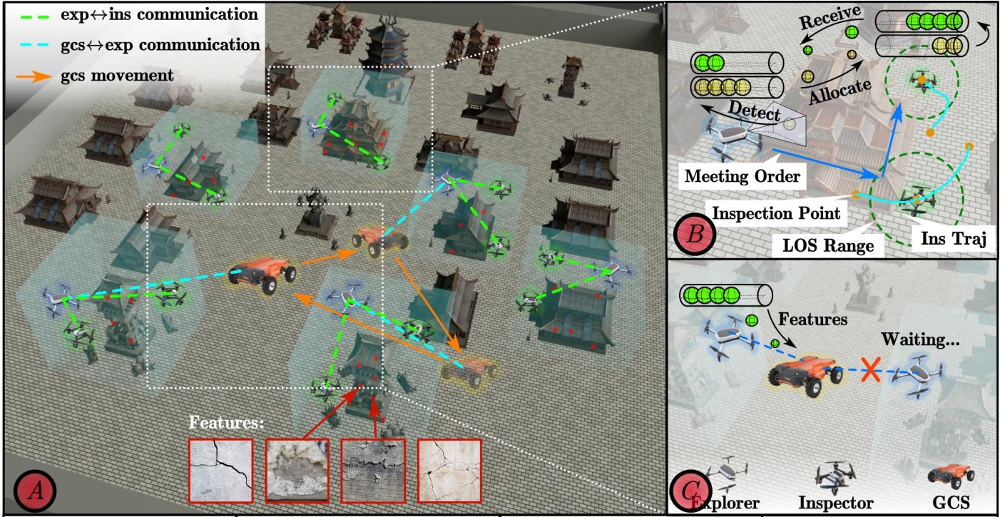
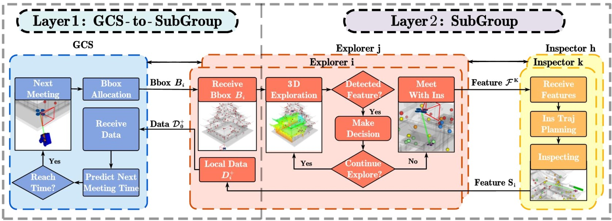

# 🚀 **[SLEI3D]**  

🌟 **Coming Soon!** 🌟  

We're thrilled to announce our upcoming project, **[SLEI3D]**! Stay tuned for cutting-edge innovations, powerful features, and a transformative open-source experience.

---

## 🔥 What is [SLEI3D]?
Robotic fleets, such as unmanned aerial and ground vehicles, are widely utilized for inspecting static environments with predefined areas of interest. However, in many real-world scenarios, such areas are unknown and must be identified dynamically during exploration. This paper addresses the challenge of simultaneous exploration, inspection of unknown environments, and real-time reporting to a moveable ground control station (GCS). 

Heterogeneous robots, equipped with complementary sensors like long-range LiDARs for exploration and close-range cameras for inspection, operate under constrained ad-hoc wireless networks, allowing communication only in close proximity and without obstructions. To tackle these challenges, we propose **SLEI3D**—a planning and coordination framework for collaborative 3D exploration, adaptive inspection, and efficient communication using intermittent or proactive protocols.

The framework incorporates multi-layer, multi-rate replanning to address uncertainties in feature locations and dynamically coordinate inter- and intra-subgroup plans. Extensive simulations, involving up to 48 robots and exploring 126,000 cubic meters, validate the framework's scalability and effectiveness for large-scale missions.

---

## 📅 **Coming Soon!**

The wait is almost over! This repository will soon be populated with:  
- 📂 Source code  
- 📖 Documentation  
- 🚀 Setup instructions  
- 💡 Tutorials  

---

## 🌐 Check Out the Website!  

Stay in the loop by visiting our official website:  
👉 **[Your Project Website](https://junfengchen-robotics.github.io/SLEI3D/)**  

---

## 📢 **Why Follow Us?**  

- 🔬 Cutting-edge innovation in [your field].  
- 📚 Comprehensive, developer-friendly resources.  
- 🌎 Open-source contributions that make a difference.

---

## 📌 Stay Updated!  

- ⭐ Star this repository to be notified when it launches!  
- 🔗 Bookmark our website for updates.  

---

## 👥 **Maintainers**

- [**Junfeng Chen**](chenjunfeng@stu.pku.edu.cn)  
- [**Yuxiao Zhu**](yz902@duke.edu)  
- [**Xintong Zhang**](xz405@duke.edu)  
- [**Meng Guo**](meng.guo@pku.edu.cn)  

For any inquiries or contributions, feel free to contact us! 🚀

